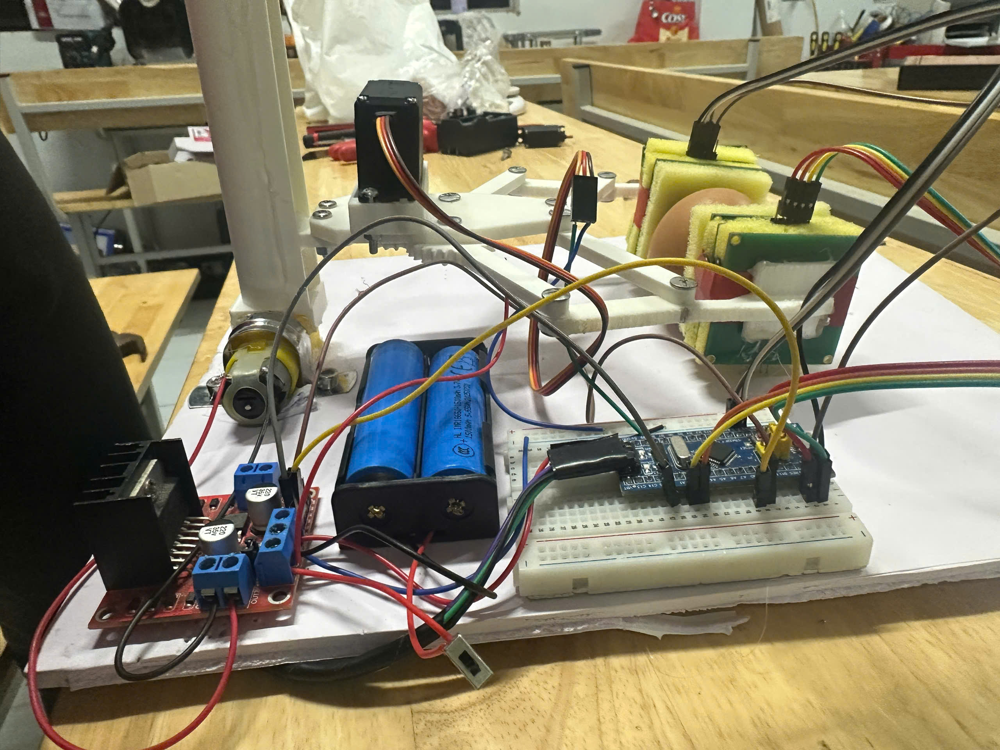
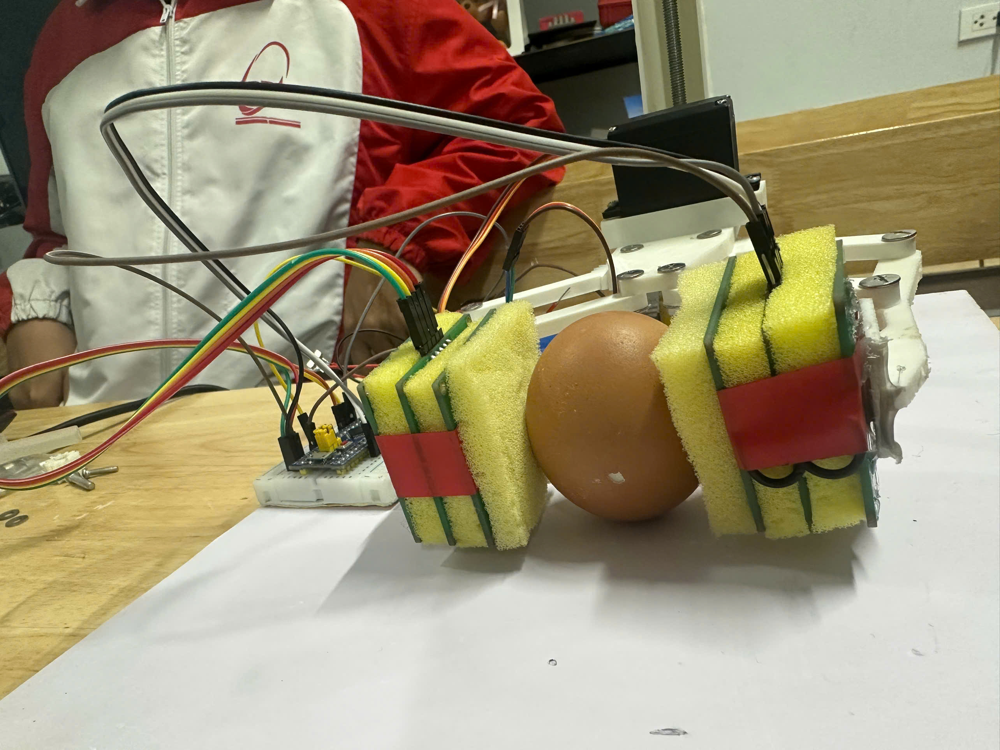
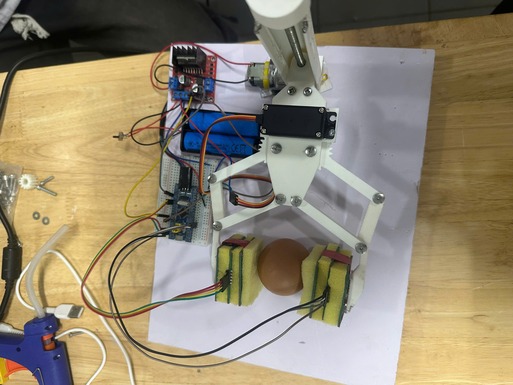
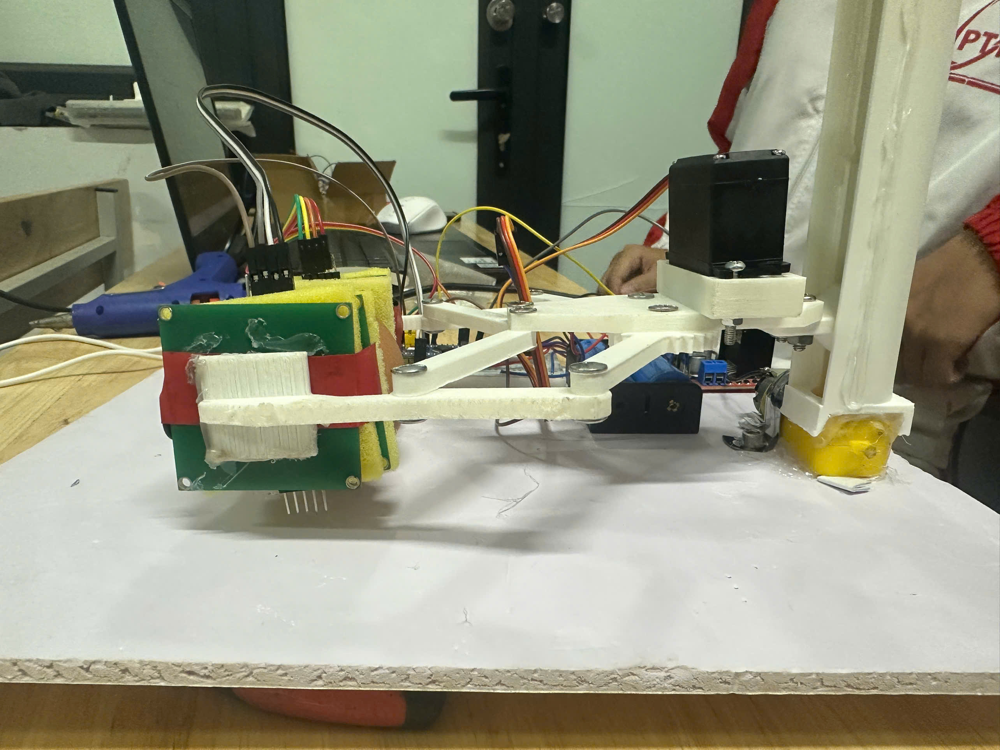

# Báo cáo tiến độ nghiên cứu ngày 21/11/2026
## A. Công việc đã làm
- Gắn cảm biến vào tay gắp
- Tiến hành gắp thử vật
## B. Khó Khăn
## C. Báo cáo chi tiết 
### 1. Gắn cảm biến vào tay gắp

  
  
   
  
  

### 2. Tiến hành đo gắp vật
- Đo để gắp quả trứng ta cho lực khoảng 6N
- Giá trị trung bình 4 chân cảm biến 2 để đạt khoảng 6N là khoảng 7
- Giá trị trung bình 4 chân cảm biến 3 để đạt khoảng 6N là khoảng 9.5

#### Video quay gắp vật
https://github.com/user-attachments/assets/3e029116-5c6c-4882-bd0b-8f2d8a6dc300
